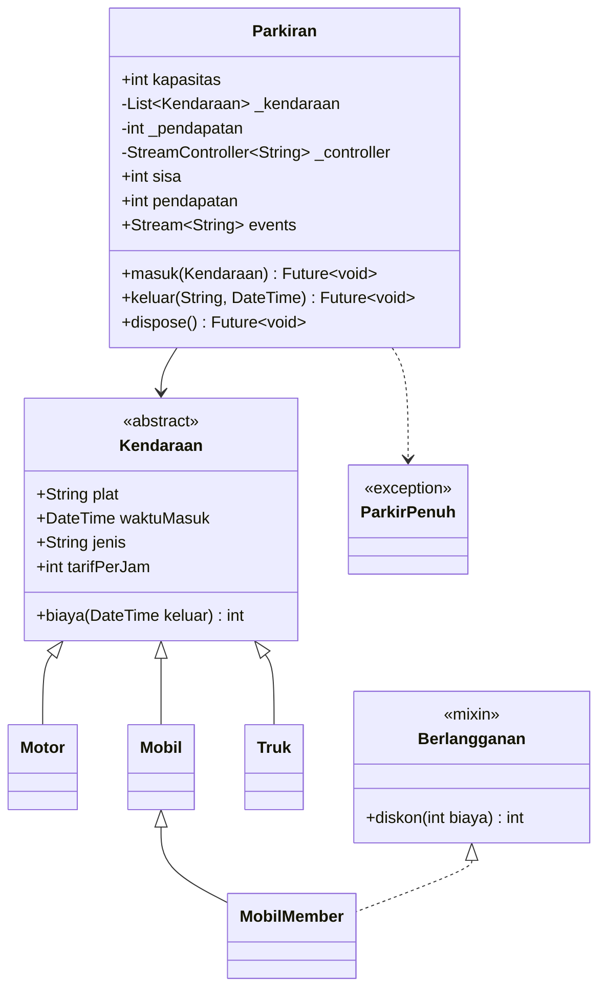
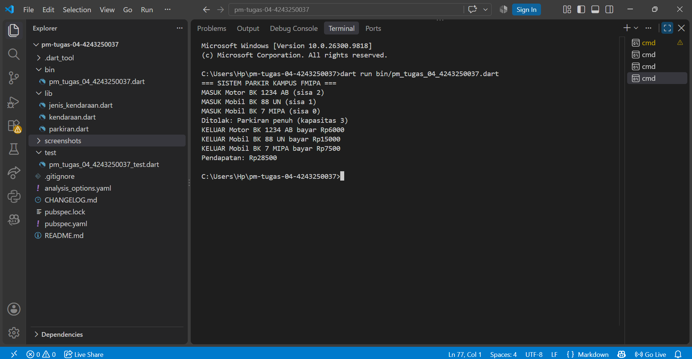
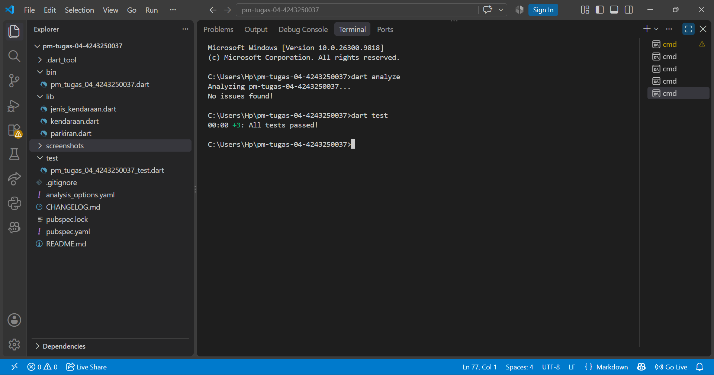

# Tugas Rutin 4 – Sistem Parkir Kampus

## 1. Identitas

- **Nama:** Lastri P. Silaban
- **NIM:** 4243250037
- **Program Studi:** Ilmu Komputer
- **Universitas:** Universitas Negeri Medan
- **Mata Kuliah:** Pemrograman Mobile

## 2. Deskripsi Program

Sistem Parkir Kampus merupakan aplikasi berbasis console yang mensimulasikan proses kendaraan masuk dan keluar pada area parkir FMIPA. Program ini menggunakan konsep Object-Oriented Programming (OOP) dan pemrograman asynchronous untuk mengelola data kendaraan, kapasitas parkir, biaya parkir, serta pendapatan.

Program menyediakan tiga jenis kendaraan, yaitu Motor, Mobil, dan Truk. Selain itu, terdapat Mobil Member yang memperoleh potongan biaya parkir sebesar 50%. Proses masuk dan keluar kendaraan disimulasikan menggunakan Future.delayed, sedangkan aktivitas parkir dikirimkan melalui StreamController.broadcast().

## 3. Diagram Class



## 4. Hasil Pengujian

### 4.1 Output Program

Program dijalankan menggunakan perintah:

```bash
dart run bin/pm_tugas_04_4243250037.dart
```

Hasil eksekusi program:



### 4.2 Pengujian Kode

Pengujian dilakukan menggunakan perintah `dart analyze` dan `dart test`.

| Perintah | Hasil |
|---|---|
| `dart analyze` | No issues found! |
| `dart test` | All tests passed! (3 pengujian) |

Bukti hasil pengujian:



## 5. Penjelasan Implementasi

Program ini menerapkan konsep Object-Oriented Programming (OOP) melalui class Kendaraan sebagai abstract class yang menjadi induk bagi Motor, Mobil, dan Truk. Konsep inheritance digunakan agar setiap jenis kendaraan mewarisi atribut plat dan waktuMasuk. Polymorphism diterapkan melalui getter jenis dan tarifPerJam yang memiliki implementasi berbeda pada setiap subclass. Encapsulation diterapkan pada class Parkiran dengan menggunakan atribut private _kendaraan dan _pendapatan, yang diakses melalui getter sisa dan pendapatan. Mixin Berlangganan digunakan pada MobilMember untuk memberikan diskon biaya parkir sebesar 50%, sedangkan overriding diterapkan pada method biaya(). Asynchronous programming digunakan melalui Future, async, await, dan Future.delayed untuk menyimulasikan proses gerbang parkir. StreamController.broadcast() digunakan untuk mengirimkan setiap aktivitas kendaraan masuk dan keluar agar dapat ditampilkan melalui listener.

## 6. Pernyataan Penggunaan AI

Dalam pengerjaan tugas ini, AI digunakan sebagai alat bantu untuk memahami konsep pemrograman Dart, menyusun struktur kode, membantu menemukan kesalahan, serta menyusun dokumentasi program. Implementasi dan pengujian program dilakukan secara langsung oleh mahasiswa.